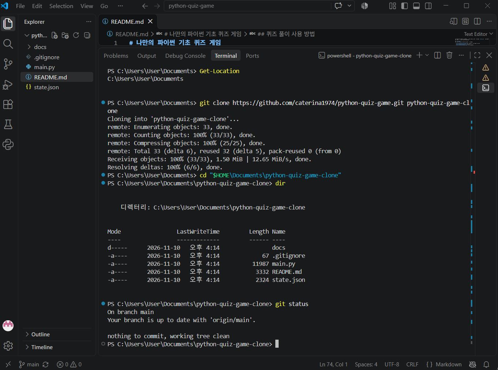
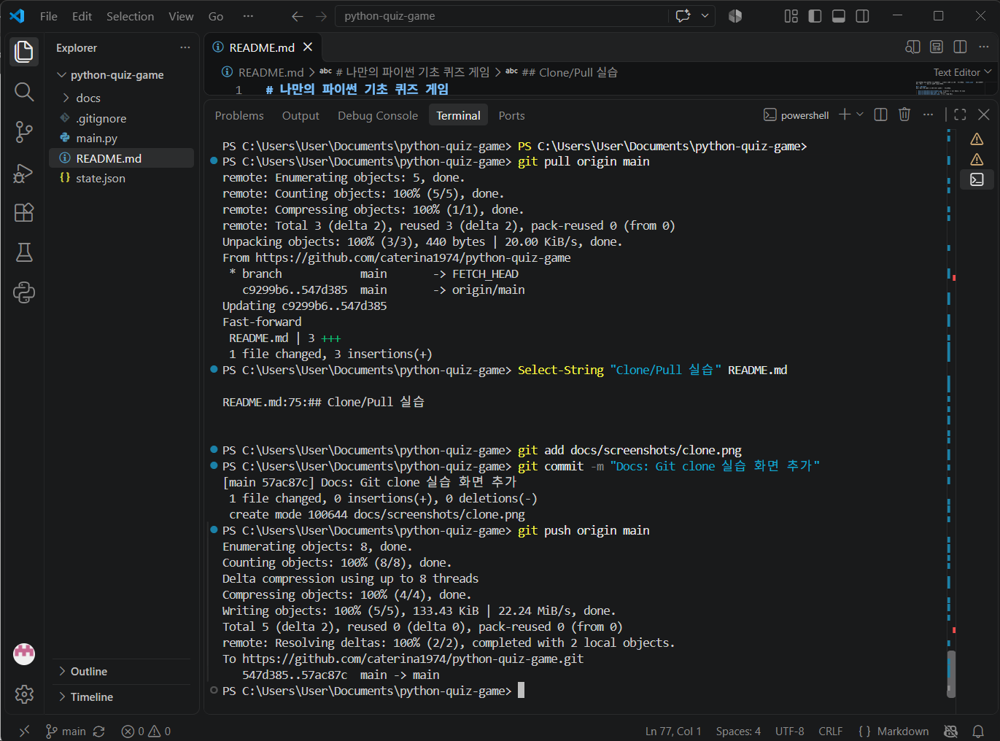

# Git clone 및 pull 실습 증빙

이 문서는 `python-quiz-game` 저장소의 Git clone 및 pull 실습 과정을 정리한 자료입니다.

저장소: https://github.com/caterina1974/python-quiz-game

## 1. Git clone 실습

`git clone`은 GitHub의 원격 저장소를 새로운 로컬 폴더에 복제할 때 사용합니다.

```powershell
git clone https://github.com/caterina1974/python-quiz-game.git
cd python-quiz-game
```

복제 후 저장소 상태를 확인합니다.

```powershell
git status
git remote -v
```

### Git clone 실습 화면



[clone.png 원본 보기](https://github.com/caterina1974/python-quiz-game/blob/main/docs/screenshots/clone.png)

## 2. Git pull 실습

`git pull`은 원격 저장소의 변경 사항을 현재 로컬 브랜치에 가져와 통합하는 명령어입니다.

복제한 작업 폴더에서 변경 사항을 push한 뒤 기존 작업 폴더에서 다음 명령어를 실행합니다.

```powershell
git pull origin main
```

가져온 변경 사항을 확인합니다.

```powershell
git status
git log --oneline -1
```

### Git pull 실습 화면



[pull.png 원본 보기](https://github.com/caterina1974/python-quiz-game/blob/main/docs/screenshots/pull.png)

## 3. Git clone과 pull의 차이

| 명령어 | 목적 |
|---|---|
| `git clone` | 원격 저장소를 새로운 로컬 폴더에 복제 |
| `git pull` | 원격 저장소의 변경 사항을 현재 로컬 저장소에 반영 |

이 프로젝트에서는 clone으로 별도 작업 폴더를 만들고, 변경 사항을 push한 다음 기존 작업 폴더에서 pull하여 변경 내용이 반영되는 것을 확인했습니다.

## 4. 증빙 이미지 위치

실습 화면은 다음 경로에 저장되어 있습니다.

- `docs/screenshots/clone.png`: Git clone 실행 화면
- `docs/screenshots/pull.png`: Git pull 실행 화면

이 문서는 실습 과정을 설명하는 Markdown 증빙 자료이며, 실제 PNG 캡처 이미지와 함께 제출합니다.
